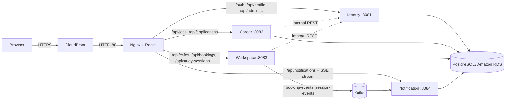
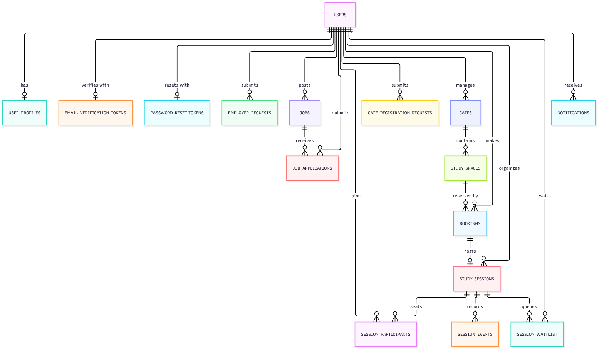
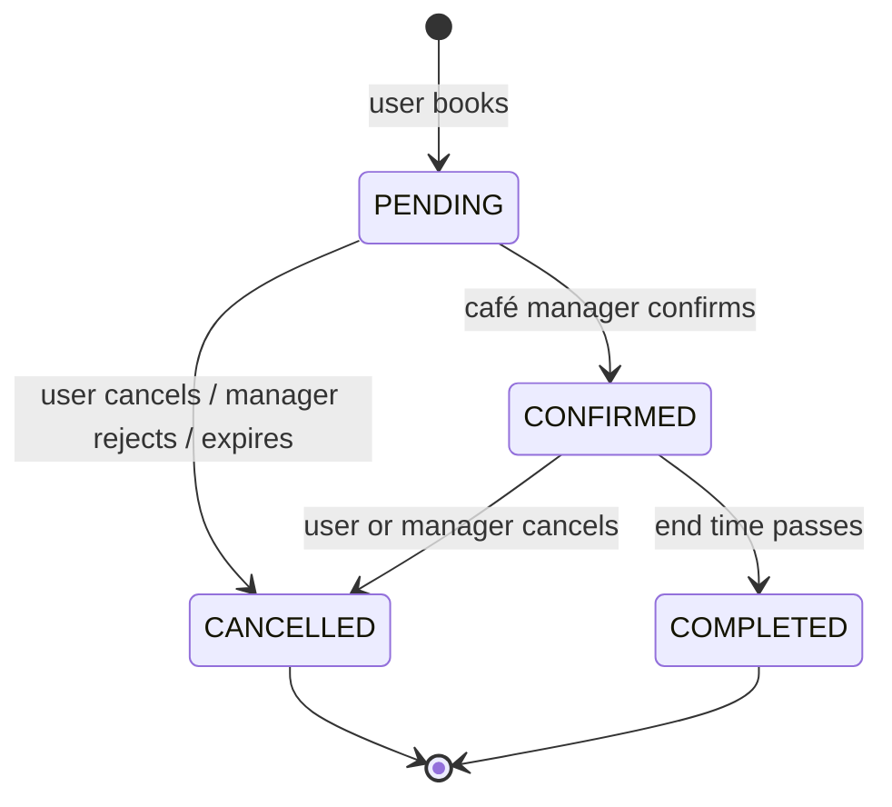
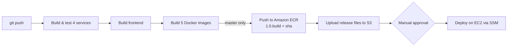

# WASLAH 4.0 — Career & Study-Space Platform (Microservices)

WASLAH connects people with **work** and with **places to work**. Job seekers browse jobs and apply; employers publish jobs and choose candidates; café managers list study spaces; students book a desk or room and turn a booking into a group study session with a fair waitlist.

The project started as a single Spring Boot application (Units 2–3). In Unit 4 it was **productionized**: split into four Spring Boot microservices, containerized with Docker, connected with Apache Kafka, built and deployed by a Jenkins CI/CD pipeline, and deployed to AWS.

## Contents

1. [Users and roles](#1-users-and-roles)
2. [Features](#2-features)
3. [Architecture](#3-architecture)
4. [Data model (ERD)](#4-data-model-erd)
5. [Asynchronous messaging with Kafka](#5-asynchronous-messaging-with-kafka)
6. [Business rules and concurrency](#6-business-rules-and-concurrency)
7. [Technology stack](#7-technology-stack)
8. [Repository layout](#8-repository-layout)
9. [Run locally with Docker Compose](#9-run-locally-with-docker-compose)
10. [API documentation](#10-api-documentation)
11. [Testing](#11-testing)
12. [CI/CD pipeline (Jenkins)](#12-cicd-pipeline-jenkins)
13. [AWS deployment](#13-aws-deployment)
14. [Security](#14-security)
15. [Project documents](#15-project-documents)
16. [Challenges, limitations and next steps](#16-challenges-limitations-and-next-steps)
17. [Credits and resources](#17-credits-and-resources)

---

## 1. Users and roles

| Role | What they can do |
| --- | --- |
| `USER` | Register, verify email, manage profile and photo, browse and apply for jobs, book study spaces, create and join study sessions, request to become an employer or café manager |
| `EMPLOYER` | Publish, edit and close jobs; review applications; accept or reject candidates |
| `CAFE_MANAGER` | Manage cafés and study spaces; confirm or cancel bookings for their cafés |
| `ADMIN` | Approve employer and café requests, manage users, view statistics and the audit log |

Every new account starts as `USER`. Higher roles are granted only by an admin approving a request.

## 2. Features

| Service | Features |
| --- | --- |
| **Identity** | Registration, email verification, JWT login, BCrypt passwords, account lockout after repeated failed logins, rate limiting on authentication endpoints, forgot/reset/change password, profile and profile image, employer requests, admin user management, statistics and audit log |
| **Career** | Create, update, close and browse jobs (filters and pagination), apply once per job, employer review of applications, vacancy counting that cannot overfill |
| **Workspace** | Cafés and study spaces, café registration requests, time-slot bookings with overlap protection, manager confirmation and cancellation, automatic expiry and completion of bookings, group study sessions, FIFO waitlist with automatic promotion, session history |
| **Notification** | Stores notifications from Kafka events, unread count, mark as read, live delivery to the browser with Server-Sent Events (SSE) |
| **Frontend** | React + TypeScript (Vite) single-page app with pages for each role, served by Nginx |

## 3. Architecture


### 3.1 Services

| Service | Port | Responsibility | Owns tables |
| --- | ---: | --- | --- |
| Identity | 8081 | Accounts, authentication, profiles, roles, admin | 6 |
| Career | 8082 | Jobs and applications | 2 |
| Workspace | 8083 | Cafés, study spaces, bookings, study sessions, waitlists | 8 |
| Notification | 8084 | Notifications, Kafka consumer, SSE | 2 |
| Frontend (Nginx) | 80 | Serves the React app and routes `/auth` and `/api/**` to the right service | – |

Each service is its own Maven project with its own Dockerfile, image, version and health check, so it can be built, tested, deployed and restarted on its own.

### 3.2 How a request flows



- **Single entry point:** the browser talks only to Nginx; it does not know service ports. Nginx forwards each path prefix to its service and blocks `/api/internal/**` from outside. There is no separate API gateway; Nginx plays that routing role.
- **Authentication without a shared session:** Identity signs a JWT that carries the user id, username and role. Every service checks the signature with the shared secret and authorizes the request itself, so no service has to call Identity just to know who the user is.
- **Synchronous service-to-service calls:** when Career or Workspace needs another user's details (for example an applicant's name) or must change a role (approving a café request makes the user `CAFE_MANAGER`), it calls Identity's internal API with a short timeout. These calls carry a secret `X-Internal-Token` header and are never reachable from the internet.
- **Asynchronous events:** after a booking or session change, Workspace publishes an event to Kafka and returns immediately. Notification consumes it, stores the notification and pushes it to the user's open SSE connection. If Notification is down, events wait in Kafka and are processed when it comes back.

### 3.3 Data

All services use **one PostgreSQL database**, but **each table belongs to one service** and is only accessed by that service. Other services refer to it by id. This keeps the deployment simple (one managed database) while still keeping ownership clear. See the [ERD](docs/ERD.md).

## 4. Data model (ERD)

Full diagrams with every entity, attribute and relationship, one per service: **[docs/ERD.md](docs/ERD.md)**.



## 5. Asynchronous messaging with Kafka

| Topic | Producer | Consumer | Events |
| --- | --- | --- | --- |
| `booking-events` | Workspace | Notification | `BOOKING_CREATED`, `BOOKING_CONFIRMED`, `BOOKING_REJECTED`, `BOOKING_CANCELLED`, `BOOKING_CANCELLED_BY_MANAGER`, `BOOKING_EXPIRED` |
| `session-events` | Workspace | Notification | `SESSION_<activity>`: joined, waitlisted, promoted, left, left waitlist, cancelled |
| `<topic>.DLT` | Notification (error handler) | – | events that still fail after retries |

- Each event is JSON with an `eventId`, `eventType`, `schemaVersion`, time, recipient user ids, message and the related booking or session. The message key is the booking or session id, so events about one booking stay in order.
- Topics have 3 partitions.
- **Retries and dead-letter topic:** a failing event is retried 3 times, 1 second apart, then moved to `<topic>.DLT` so it does not block the others.
- **Idempotency:** Notification records every handled `eventId` in `processed_events` in the same transaction as the notification, so a redelivered event never creates a duplicate.

Details: [docs/KAFKA_EVENTS.md](docs/KAFKA_EVENTS.md).

## 6. Business rules and concurrency

### Bookings



- The time slot must be in the future and the study space available.
- Two active bookings of the same space cannot overlap (`existing.start < new.end AND existing.end > new.start`). The check and the insert run in one transaction with a row lock, so two simultaneous requests for the same slot cannot both succeed.
- A scheduler expires unanswered pending bookings and completes finished ones every minute.

### Group study sessions

- A session is created from a **confirmed** booking; its capacity cannot exceed the study space capacity. The organizer takes the first seat.
- A user cannot join the same session twice or two overlapping sessions.
- When a session is full, users join a **FIFO waitlist**. When someone leaves, the earliest eligible waiting user is promoted automatically.
- Cancelling the booking cancels its session, clears the waitlist and notifies everyone.
- All joins, leaves, promotions and cancellations take the same PostgreSQL transaction-level advisory lock, so they run one at a time even across several Workspace instances. The capacity is never exceeded and the waitlist order stays correct.

### Jobs

- A user can apply once per job. Accepting a candidate locks the job row, so simultaneous acceptances cannot fill more positions than the vacancies.

## 7. Technology stack

| Area | Technology |
| --- | --- |
| Backend | Java 17, Spring Boot 4, Spring Web MVC, Spring Data JPA (Hibernate), Lombok |
| Security | Spring Security, JWT (jjwt), BCrypt, Bean Validation |
| Database | PostgreSQL 17 (Amazon RDS in production); H2 for tests |
| Messaging | Apache Kafka 3.9 (KRaft mode), Spring Kafka; Server-Sent Events |
| Frontend | React, TypeScript, Vite, Nginx |
| Testing | JUnit 5, Spring Boot Test, Cucumber, Testcontainers |
| Containers | Docker, Docker Compose |
| CI/CD | Jenkins (pipeline as code, configuration as code) |
| Cloud | AWS: EC2, RDS, ECR, S3, CloudFront, Systems Manager, IAM, CloudWatch, SNS |
| API docs | springdoc OpenAPI / Swagger UI, Postman |

## 8. Repository layout

```text
updated-waslah/
├── Jenkinsfile                      CI/CD pipeline
├── services/
│   ├── identity_service/            Spring Boot service (port 8081)
│   ├── career_service/              Spring Boot service (port 8082)
│   ├── workspace_service/           Spring Boot service (port 8083)
│   ├── notification_service/        Spring Boot service (port 8084)
│   └── .env.example                 configuration template (copy to .env, never commit)
├── frontend/                        React app + Nginx config + Dockerfile
├── infrastructure/
│   ├── docker/compose.yaml          whole system on one machine
│   ├── docker/compose.prod.yaml     production stack on EC2 (images from ECR, RDS database)
│   ├── db/                          database schema and demo data
│   ├── aws/setup.sh, teardown.sh    create / delete all AWS resources
│   ├── aws/scripts/deploy.sh        deploy script run on EC2
│   └── jenkins/                     Jenkins image, plugins, configuration as code
└── docs/                            ERD, architecture, Kafka, API, CI/CD, diagrams
```

## 9. Run locally with Docker Compose

**Prerequisites:** Docker Desktop, Git. (Java 17 and Node 20 only if you want to run a service outside Docker.)

```powershell
git clone https://github.com/Noor-Shafeeq-Ashoor/updated-waslah.git
cd updated-waslah
copy services\.env.example services\.env      # then set the passwords and secrets in it
docker compose --env-file services/.env -f infrastructure/docker/compose.yaml up -d --build
```

| Open | Address |
| --- | --- |
| Application | http://localhost |
| Swagger UI | http://localhost:8081/swagger-ui/index.html (8082, 8083, 8084 for the other services) |
| Health | http://localhost:8081/actuator/health (same pattern per service) |
| Kafka UI (optional) | add `--profile tools`, then http://localhost:8085 |
| Second Workspace instance (optional) | add `--profile scale`, port 8093 |

Compose starts PostgreSQL (host port 5433), Kafka, the four services and the frontend. Each container has a health check, restarts automatically and has a memory limit. Stop with `docker compose -f infrastructure/docker/compose.yaml down`.

## 10. API documentation

- **Swagger UI** for each service (see the table above) lists every endpoint with its request and response.
- **Reference:** [docs/API_DOCUMENTATION.md](docs/API_DOCUMENTATION.md).
- Protected endpoints need `Authorization: Bearer <token>` from `POST /auth/login`.

| Service | Main endpoints |
| --- | --- |
| Identity | `POST /auth/register`, `POST /auth/login`, `GET /auth/verify-email`, `POST /auth/forgot-password`, `POST /auth/reset-password`, `GET/PUT /api/profile`, `PUT /api/profile/image`, `PUT /api/users/change-password`, `POST /api/employer-requests`, `/api/admin/users`, `/api/admin/employer-requests`, `/api/admin/stats`, `/api/admin/audit-logs` |
| Career | `GET/POST /api/jobs`, `GET /api/jobs/my`, `GET/PUT/DELETE /api/jobs/{id}`, `POST /api/applications/jobs/{jobId}`, `GET /api/applications/my`, `GET /api/applications/jobs/{jobId}`, `PUT /api/applications/{id}/status` |
| Workspace | `/api/cafes`, `/api/cafes/{cafeId}/study-spaces`, `GET /api/study-spaces`, `POST/GET /api/bookings`, `PUT /api/bookings/{id}/cancel`, `/api/manager/bookings` (confirm / cancel), `/api/cafe-requests`, `POST /api/study-sessions`, `POST /api/study-sessions/{id}/join`, `/leave`, `/events` |
| Notification | `GET /api/notifications`, `GET /api/notifications/unread-count`, `PUT /api/notifications/{id}/read`, `GET /api/notifications/stream` (SSE) |

Errors use one format in every service:

```json
{ "timestamp": "2026-11-18T10:30:00", "status": 409, "error": "CONFLICT",
  "message": "The study space is already booked for this time", "path": "/api/bookings" }
```

## 11. Testing

```powershell
cd services\workspace_service
$env:SPRING_PROFILES_ACTIVE = "test"
.\mvnw.cmd verify
```

| Test | Where | What it proves |
| --- | --- | --- |
| Application context tests | all 4 services | Each service starts with its configuration (H2, no Kafka needed) |
| Cucumber BDD (`booking.feature`, 3 scenarios) | Workspace | Booking rules described in plain Given/When/Then language |
| `BookingConcurrencyIT` (Testcontainers, PostgreSQL 17) | Workspace | Two simultaneous bookings of the same slot: exactly one succeeds |

`mvn verify` runs both unit tests (Surefire) and integration tests (Failsafe); the Testcontainers test needs Docker. The same tests run in the pipeline, and a failing test stops it.

## 12. CI/CD pipeline (Jenkins)

The pipeline is the [`Jenkinsfile`](Jenkinsfile). Jenkins runs in Docker (`infrastructure/jenkins`) and is configured entirely from code: plugins, credentials and the job.



- Every pushed branch is built and tested; only `master` is pushed and deployed.
- Images are tagged with a version (`1.0.<build>`) and the commit (`sha-<commit>`), never only `latest`.
- Deployment needs a manual **Deploy** approval. A failed build, test or deployment marks the run red and stops it.
- **Rollback:** run the job with `ROLLBACK_VERSION=1.0.x` to redeploy an earlier version without rebuilding.
- The repository also keeps a GitHub Actions workflow (`.github/workflows/ci-cd.yml`) that runs the same build and tests on GitHub. Its deploy job only runs when its AWS variables are configured; Jenkins is the deployment path.

Details: [docs/ci-cd.md](docs/ci-cd.md).

## 13. AWS deployment

Region **us-east-1**. All resources are created by `infrastructure/aws/setup.sh` and removed by `teardown.sh`.

| AWS service | Use |
| --- | --- |
| CloudFront | Public HTTPS address in front of the application |
| EC2 (t3.large, Amazon Linux 2023) | Runs the containers with Docker Compose (`compose.prod.yaml`) |
| RDS for PostgreSQL 17 | Managed database, **not publicly accessible**, encrypted |
| ECR | One private repository per image, scan on push |
| S3 | Private bucket holding the release files for each version |
| Systems Manager | Parameter Store for secrets; Run Command for deployment; Session Manager instead of SSH |
| IAM | EC2 role (read images, secrets, release files); Jenkins user limited to push, upload and deploy |
| CloudWatch + SNS + Budgets | CPU, status-check and storage alarms by email; monthly cost alert |

**How a deployment works:** Jenkins pushes the images and uploads `compose.prod.yaml`, the schema and `deploy.sh` to S3, then asks Systems Manager to run `deploy.sh <version>` on EC2. The script loads the secrets from Parameter Store into a protected `.env` file, creates the database tables on the first deployment, pulls the exact image version from ECR and starts the stack, waiting until every container reports healthy.

**Environment-specific configuration:** the same images run everywhere; only the environment changes (local `.env` with Docker PostgreSQL versus Parameter Store with RDS).

## 14. Security

- **Network:** only CloudFront can reach the server (security group with AWS's CloudFront address list, port 80 only); no SSH port is open. The database accepts connections only from the server and requires TLS. Service ports are not published; only Nginx is.
- **Secrets:** never in Git. Locally in `services/.env` (ignored by Git); in AWS in Parameter Store (encrypted). Jenkins keeps its AWS key in its credentials store.
- **Least privilege:** the EC2 role and the Jenkins user can do only what deployment needs.
- **Application:** BCrypt passwords, JWT with role checks in every service, ownership checks (users only change their own data), account lockout, rate limiting, validated input, internal API protected by a secret token and blocked at Nginx.
- **Data:** RDS storage and EC2 disks encrypted; ECR images scanned for vulnerabilities.

## 15. Project documents

| Document | Content |
| --- | --- |
| [docs/ERD.md](docs/ERD.md) | ERD per service: entities, attributes, relationships |
| [docs/ARCHITECTURE.md](docs/ARCHITECTURE.md) | Architecture and communication |
| [docs/KAFKA_EVENTS.md](docs/KAFKA_EVENTS.md) | Kafka topics and event contract |
| [docs/API_DOCUMENTATION.md](docs/API_DOCUMENTATION.md) | API reference |
| [docs/ci-cd.md](docs/ci-cd.md) | Jenkins pipeline |
| [PROJECT PLAN.md](PROJECT%20PLAN.md) | Plan and progress, Units 2–4 |
| [USER STORY.md](USER%20STORY.md) | User stories and acceptance criteria |

## 16. Challenges, limitations and next steps

**Challenges**

1. **Splitting the monolith** without breaking login, roles and business rules: user links became ids, and user details come from Identity's internal API.
2. **Keeping data correct under concurrency:** double bookings, over-capacity sessions, duplicate promotions and overfilled vacancies, solved with transactions, row locks, advisory locks and unique constraints, and proven with a Testcontainers test on real PostgreSQL.
3. **Reliable events:** retries, a dead-letter topic and idempotent consumption so notifications are neither lost nor duplicated.
4. **Deployment automation:** versioned images, secrets outside Git, and a deployment that starts the exact version and waits for health checks.

**Limitations**

- One shared PostgreSQL database (with ownership per service), not one database per service.
- One EC2 host and one Kafka broker: simple and low-cost, but not highly available.
- No response caching yet.
- Jenkins runs on a local machine and checks GitHub every 2 minutes instead of receiving webhooks.

**Next steps**

- Cache frequently read lists (jobs, cafés) with Spring Cache and Redis.
- Separate databases per service, with events to keep data in sync.
- Run on ECS or EKS behind a load balancer, with several Kafka brokers (Amazon MSK).
- More unit and end-to-end tests, and centralized logs in CloudWatch.

## 17. Credits and resources

| Resource | Used for |
| --- | --- |
| [Spring Boot](https://docs.spring.io/spring-boot/) · [Spring Security](https://docs.spring.io/spring-security/reference/) · [Spring for Apache Kafka](https://docs.spring.io/spring-kafka/reference/) | Services, security, Kafka integration |
| [jjwt](https://github.com/jwtk/jjwt) · [springdoc-openapi](https://springdoc.org/) · [Project Lombok](https://projectlombok.org/) | JWT, Swagger, boilerplate |
| [PostgreSQL](https://www.postgresql.org/docs/) · [Apache Kafka](https://kafka.apache.org/documentation/) | Database, locking, messaging |
| [Docker](https://docs.docker.com/) · [Jenkins](https://www.jenkins.io/doc/) · [AWS](https://docs.aws.amazon.com/) | Containers, CI/CD, cloud |
| [Cucumber](https://cucumber.io/docs/cucumber/) · [Testcontainers](https://java.testcontainers.org/) | BDD and integration tests |
| [Java concurrency tutorial](https://docs.oracle.com/javase/tutorial/essential/concurrency/) | Concurrency concepts |
