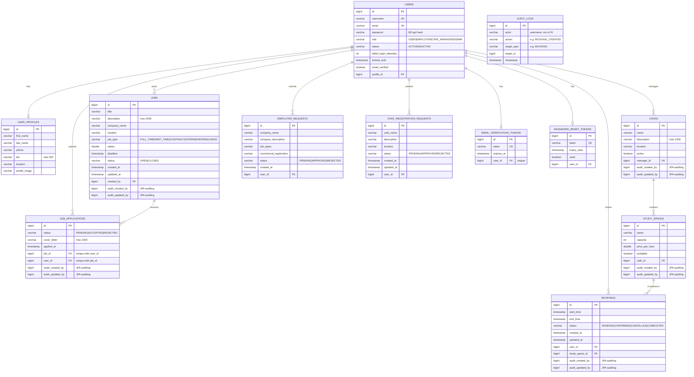

# WASLAH — Jobs & Study-Space Booking API

A secure Spring Boot REST API that connects people to **work opportunities** and **places to work**: users can browse and apply for jobs posted by verified employers, and book desks or rooms in partner cafés.

> Built for **Project 2 — Build a Secure Spring Boot REST API** (Unit 2 Backend Application).

---

## Table of Contents

1. [Project Information](#project-information)
2. [Technologies](#technologies)
3. [Architecture](#architecture)
4. [General Approach](#general-approach)
5. [Business Rules](#business-rules)
6. [User Stories](#user-stories)
7. [ERD](#erd)
8. [Planning](#planning)
9. [API Documentation](#api-documentation)
10. [Installation](#installation)
11. [Testing](#testing)
12. [Major Challenges](#major-challenges)
13. [Future Improvements](#future-improvements)
14. [Credits & External Resources](#credits--external-resources)

---

## Project Information

**Title:** WASLAH API

**Description:** WASLAH is a backend platform with two connected halves:

- **Jobs** — employers publish job postings; job seekers browse them and apply.
- **Study-space booking** — café managers list their cafés and study spaces (quiet desks, group rooms, meeting rooms); users book a space for a time slot, and the café manager confirms or rejects the booking.

**Purpose:** Many students, freelancers and job seekers in Bahrain need both a place to work and a route to employment. WASLAH puts both in one system, with role-based access so each type of user only sees and does what they should.

**Users / roles**

| Role | What they can do |
|---|---|
| `USER` | Register, manage own profile, browse/apply for jobs, book study spaces, request upgrade to Employer or Café Manager |
| `EMPLOYER` | Create, update and close own job postings; review and accept/reject applications to own jobs |
| `CAFE_MANAGER` | Manage own cafés (create, update, deactivate/activate); confirm or reject bookings for own cafés |
| `ADMIN` | Deactivate users; approve or reject Employer and Café Manager requests |

**Main features**

- Registration with **email verification** (real emails over SMTP; link valid 24 hours)
- **JWT login** (24-hour tokens), BCrypt password hashing, temporary account lock after repeated failed logins
- **Forgot-password / reset-password** (single-use token, 15 minutes) and **change-password** for logged-in users
- **Role-based authorization** enforced with Spring Security (`@PreAuthorize` + service-layer ownership checks)
- Admin-approved **role upgrade workflows** (User → Employer, User → Café Manager)
- **Booking workflow** with availability checks, double-booking prevention (row lock + overlap query) and status transitions (`PENDING → CONFIRMED / CANCELLED`; `CONFIRMED → COMPLETED` automatically after the end time)
- **Real-time notifications** over Server-Sent Events (SSE) when a booking is created, fails, is confirmed, rejected or cancelled
- **Job workflow**: posting, closing, applying (one application per user per job), accept/reject
- **Search, filtering, pagination and sorting** on cafés, study spaces, jobs, bookings and the audit log
- **Soft delete** for users (`INACTIVE`), cafés (`active = false`) and jobs (`CLOSED`)
- **Profile pictures stored as files** on disk (UUID file names, JPG/PNG only, 5 MB max, validated by content)
- **Rate limiting** on login, registration and password-recovery endpoints
- **Audit log** (database table + admin endpoint) and **application logging** with SLF4J
- **Spring profiles** (`dev`, `test`, `prod`); secrets are read from environment variables
- Consistent JSON **error responses** via a global exception handler
- **Swagger / OpenAPI** documentation with descriptions, examples and per-endpoint status codes
- **Database seeding** of an **admin** (from environment variables), a demo café manager, two cafés and five study spaces on first start

---

## Technologies

| Technology | Purpose |
|---|---|
| Java 17 | Language |
| Spring Boot 4.1.1 | Application framework, embedded Tomcat |
| Spring Web MVC | REST controllers |
| Spring Data JPA / Hibernate | ORM and repositories |
| Spring Security | Authentication, authorization, BCrypt hashing |
| JWT (jjwt 0.11.5) | Stateless token authentication |
| PostgreSQL | Relational database (`dev` / `prod` profiles) |
| H2 (in-memory) | Database for the `test` profile |
| Spring Mail (SMTP) | Verification and password-reset emails |
| Server-Sent Events (`SseEmitter`) | Real-time notifications |
| Spring Data JPA auditing | `createdBy` / `lastModifiedBy` columns |
| Bean Validation (Jakarta) | Server-side request validation |
| springdoc-openapi 3.0.0 (Swagger UI) | Interactive API documentation |
| Lombok | Boilerplate reduction |
| JUnit 5 / Spring Boot Test | Unit tests |
| Maven (wrapper included) | Build tool |
| Git / GitHub | Version control |

---

## Architecture

WASLAH follows a classic **layered architecture**. Each layer has one responsibility and only talks to the layer beneath it:

```
Client (Postman / Swagger UI)
        │  HTTP + JWT
        ▼
Security filter chain  ── JwtAuthenticationFilter, RateLimitingInterceptor
        ▼
Controller   ── HTTP concerns only: routing, @Valid, status codes
        ▼
Service      ── business rules, ownership checks, state transitions
        ▼
Repository   ── Spring Data JPA queries
        ▼
PostgreSQL
```

### Package structure

```
src/main/java/com/ga/waslah
├── config/        DataLoader (seed data), OpenApiConfig (Swagger + JWT scheme),
│                  WaslahAuditorAware (JPA auditing)
├── controller/    REST controllers (Auth, User, Profile, Job, JobApplication, Cafe,
│                  StudySpace, Booking, CafeManagerBooking, EmployerRequest,
│                  CafeRegistration, Notification, Admin, AdminAuditLog…)
├── dto/           Request/response objects (PageResponse for paginated lists)
├── event/         BookingCreatedEvent + listener (notifies after the transaction commits)
├── exception/     Custom exceptions + GlobalExceptionHandler + ErrorResponse
├── model/         JPA entities and status/role enums
├── repository/    Spring Data JPA repositories (+ Specification support)
├── security/      SecurityConfig, JwtService, JwtAuthenticationFilter,
│                  MyUserDetails(Service), RateLimitingInterceptor, WebConfig
├── service/       Business logic, NotificationService (SSE), AuditService,
│                  email services, ProfileImageStorageService
└── util/          PagingUtil (safe paging/sorting), Specs (dynamic filters)
```

### Major components

- **`SecurityConfig`** — stateless JWT security. Only registration, login, email verification, password recovery and Swagger routes are public; **every other route requires a valid JWT**. 401 and 403 responses from the security layer use the same JSON shape as application errors.
- **`JwtService` / `JwtAuthenticationFilter`** — issue and validate HS256 tokens (24-hour expiry); invalid or expired tokens are rejected.
- **`RateLimitingInterceptor`** — per-IP, per-endpoint request limiter (see [Business Rules](#business-rules)).
- **`GlobalExceptionHandler`** — maps exceptions to the standard error body and hides internal details (no stack traces).
- **`NotificationService` + `BookingEventListener`** — keep one SSE connection per subscribed client and push events to the right user once a booking transaction has committed.
- **`AuditService`** — writes who did what to which record into the `audit_logs` table (admins read it through `GET /api/admin/audit-logs`).
- **`PagingUtil` / `Specs`** — validate page, size, sort field and direction (whitelisted per endpoint) and build optional filters, so list endpoints filter and paginate in the database.
- **`ProfileImageStorageService`** — checks size, content type and file signature, stores the image under a random UUID name in `app.upload.profile-images-dir`, and saves only that name in the database.
- **`DataLoader`** — seeds demo data on startup if it does not already exist.
- **DTOs** — requests are validated with Bean Validation; most responses are DTOs and never include password hashes.

### Error response format

Every error uses the same structure:

```json
{
  "timestamp": "2026-10-15T10:30:00",
  "status": 404,
  "error": "RESOURCE_NOT_FOUND",
  "message": "Booking not found",
  "path": "/api/bookings/42"
}
```

Status codes used: `200`, `201`, `204`, `400`, `401`, `403`, `404`, `409`, `429`, `500`.

---

## General Approach

**How I approached the project.** I started from the problem — people need both work and a place to work — and wrote user stories for each type of user before touching code. From those I derived the roles, the data model and the business rules, then built the project in layers following the [project plan](./PROJECT%20PLAN.md): database models and repositories first, then services and core APIs, then authentication and role-based authorization, account security (password recovery, rate limiting), the booking module, and finally testing and validation.

**How I structured the application.** Controllers are deliberately thin: they accept a validated DTO, call a service and return a status code. All business decisions — "is this space free?", "does this booking belong to this user?", "can this job still accept applications?" — live in the service layer, which makes them easy to unit test. Authorization happens at two levels: coarse role checks at the route (`@PreAuthorize`) and fine-grained ownership checks inside services (a café manager can only manage bookings for *their* café; an employer can only edit *their* jobs).

**How the major features were implemented.**

- *Authentication:* register → verification email → verify → login → JWT. Login rejects unverified and inactive accounts, and locks an account for one minute after three wrong passwords.
- *Booking:* a booking starts `PENDING`; while `PENDING` or `CONFIRMED` it blocks its time slot, so an overlapping request is refused. Cancelling frees the slot. The café manager confirms or rejects pending bookings.
- *Role upgrades:* public registration always creates a `USER`. Becoming an `EMPLOYER` or `CAFE_MANAGER` requires submitting a request that an `ADMIN` must approve — so privileged roles can never be self-assigned.
- *Soft delete:* "deleting" a user sets `status = INACTIVE`, which blocks login while preserving their bookings, applications and history.

---

## Business Rules

| # | Rule | Enforced in |
|---|---|---|
| 1 | An unverified user cannot log in | `AuthController` |
| 2 | An inactive (deactivated) user cannot log in | `AuthController` |
| 3 | Three failed logins lock the account for 1 minute | `UserService` |
| 4 | Login / register: 5 requests per minute per IP; forgot / reset password: 3 per minute per IP (HTTP `429`) | `RateLimitingInterceptor` |
| 5 | Registration always creates a `USER`; usernames and emails must be unique (`409`) | `UserService` |
| 6 | Email-verification tokens expire after 24 hours; password-reset tokens expire after 15 minutes and can be used once | token services |
| 7 | Changing a password requires the current password, and the new one must differ | `UserService` |
| 8 | A booking's end must be after its start, and both must be in the future | `BookingRequest`, `BookingService` |
| 9 | A study space cannot be booked if it is unavailable or overlaps an existing `PENDING`/`CONFIRMED` booking; the study-space row is locked (`SELECT … FOR UPDATE`) during the check so two simultaneous requests cannot both succeed | `BookingService`, `StudySpaceRepository` |
| 10 | Users can only view or cancel **their own** bookings; completed or already-cancelled bookings cannot be cancelled | `BookingService` |
| 11 | A café manager can only confirm/reject **pending** bookings for **their own** cafés | `CafeManagerBookingService` |
| 12 | Only the owning café manager can update, deactivate or activate a café | `CafeService` |
| 13 | Only employers can post jobs, and only the job's owner can edit or close it; a closed job cannot be edited | `JobService` |
| 14 | Users can only apply to `OPEN` jobs before the deadline, and only once per job (`409`) | `JobApplicationService` |
| 15 | Only the job's employer can accept/reject applications, and only `PENDING` applications can be decided | `JobApplicationService` |
| 16 | An employer or café-manager upgrade needs admin approval; a user can't have more than one open employer request | `EmployerRequestService`, `CafeRegistrationService` |
| 17 | Only an admin can deactivate users; an already-inactive user returns `409` | `UserService` |
| 18 | Important actions are written to the audit log with the acting user: bookings (create / cancel / confirm / reject), cafés (create / update / activate / deactivate), jobs (create / update / close), job applications (submit / accept / reject), café requests (submit / approve / reject), employer-request decisions and user deactivation | `AuditService` |
| 19 | Profile pictures: JPG/PNG only, max 5 MB, content is checked, stored under a generated UUID name; a replaced picture is deleted from disk | `ProfileImageStorageService` |

### Booking status transitions

| From | To | Who / what |
|---|---|---|
| — | `PENDING` | User creates a booking |
| `PENDING` | `CONFIRMED` | Café manager confirms (own café only) |
| `PENDING` / `CONFIRMED` | `CANCELLED` | User cancels their own booking, or the café manager rejects a `PENDING` one |
| `CONFIRMED` | `COMPLETED` | Scheduled job (runs every minute) once the end time has passed |
| `COMPLETED` / `CANCELLED` | — | Final states; `PENDING`/`CONFIRMED` bookings block the time slot, `CANCELLED` does not |

---

## User Stories

User stories are documented in [`USER STORY.md`](./USER%20STORY.md).


---

## ERD

Entity Relationship Diagram (written from the JPA entities; 12 tables — `AUDIT_LOGS` is standalone because it stores the actor's username, not a foreign key):




## Planning

The project was divided into daily deliverables (planning, database, core APIs, authentication, account security, booking module, testing). The full plan is in [`PROJECT PLAN.md`](./PROJECT%20PLAN.md).

---

## API Documentation

### Interactive documentation (Swagger / OpenAPI)

Once the application is running:

| | URL |
|---|---|
| Swagger UI | <http://localhost:8080/swagger-ui/index.html> |
| OpenAPI JSON | <http://localhost:8080/v3/api-docs> |

To call protected endpoints from Swagger UI: `POST /auth/login` → copy the `token` from the response → click **Authorize** → paste the token (without `Bearer `) → run requests. Public endpoints show no lock icon; every endpoint lists its possible status codes and the roles it needs.

### Authentication

Protected endpoints need the JWT in the `Authorization` header:

```http
Authorization: Bearer <JWT_TOKEN>
```

Missing, invalid or expired tokens return `401`. A valid token without the required role (or accessing someone else's resource) returns `403`.

### Endpoint reference

**Access levels:** *Public* = no token · *Private* = any valid token · *User / Employer / Café Manager / Admin* = valid token **and** that role. "(owner)" = the resource must also belong to the caller.

#### Authentication & account

| Request | URL | Functionality | Access |
|---|---|---|---|
| POST | `/auth/register` | Register a new user (rate limited) | Public |
| GET | `/auth/verify-email?token=` | Verify email address | Public |
| POST | `/auth/login` | Log in, receive JWT (rate limited) | Public |
| POST | `/auth/forgot-password` | Request a password-reset token (rate limited) | Public |
| GET | `/auth/reset-password?token=` | Target of the link in the reset email: checks the token and explains the next step (rate limited) | Public |
| POST | `/auth/reset-password` | Reset password using a token (rate limited) | Public |
| GET | `/auth/test` | Check that a JWT is accepted | Private |
| PUT | `/api/users/change-password` | Change own password | Private |
| DELETE | `/api/users/{id}` | Deactivate a user (soft delete → `INACTIVE`) | Admin |
| DELETE | `/api/admin/users/{id}` | Deactivate a user (same action, admin route) | Admin |
| GET | `/api/admin/audit-logs?page=&size=&sort=` | Paginated audit trail | Admin |
| GET | `/api/notifications/stream` | Open an SSE stream of real-time notifications | Private |

#### Profile

| Request | URL | Functionality | Access |
|---|---|---|---|
| GET | `/api/profile` | Get own profile | Private |
| PUT | `/api/profile` | Update own profile | Private |
| PUT | `/api/profile/image` | Upload profile image (multipart field `image`; replaces and deletes the old file) | Private |
| GET | `/api/profile/image` | Download own profile image (`image/jpeg` or `image/png`) | Private |

#### Jobs & applications

| Request | URL | Functionality | Access |
|---|---|---|---|
| GET | `/api/jobs?jobType=&status=&location=&keyword=&page=&size=&sort=&direction=` | Search jobs (paginated; `sort` = `createdAt`, `deadline`, `salary` or `title`; newest first by default) | Private |
| GET | `/api/jobs/{id}` | Get a job | Private |
| POST | `/api/jobs` | Create a job | Employer |
| PUT | `/api/jobs/{id}` | Update a job | Employer (owner) |
| DELETE | `/api/jobs/{id}` | Close a job (soft delete → `CLOSED`) | Employer (owner) |
| POST | `/api/applications/jobs/{jobId}` | Apply to a job | User |
| GET | `/api/applications/my` | List own applications | Private |
| GET | `/api/applications/jobs/{jobId}` | List applications for a job | Employer (owner) |
| PUT | `/api/applications/{applicationId}/status?status=ACCEPTED\|REJECTED` | Accept or reject an application | Employer (owner) |

#### Role-upgrade requests

| Request | URL | Functionality | Access |
|---|---|---|---|
| POST | `/api/employer-requests` | Request to become an Employer | User |
| GET | `/api/employer-requests/my` | View own employer request | Private |
| GET | `/api/admin/employer-requests` | List pending employer requests | Admin |
| PUT | `/api/admin/employer-requests/{id}/approve` | Approve (user becomes `EMPLOYER`) | Admin |
| PUT | `/api/admin/employer-requests/{id}/reject` | Reject | Admin |
| POST | `/api/cafe-requests` | Request to register a café / become a Café Manager | User |
| GET | `/api/cafe-requests/my` | List own café requests | Private |
| GET | `/api/cafe-requests/pending` | List pending café requests | Admin |
| PUT | `/api/cafe-requests/{id}/decision` | Approve or reject (`{"decision":"APPROVED"}`) | Admin |

#### Cafés, study spaces & bookings

| Request | URL | Functionality | Access |
|---|---|---|---|
| GET | `/api/cafes?name=&location=&page=&size=&sort=&direction=` | Search active cafés (paginated; `sort` = `name` or `location`) | Private |
| GET | `/api/cafes/{id}` | Get a café | Private |
| GET | `/api/cafes/my` | List own cafés | Café Manager |
| POST | `/api/cafes` | Create a café | Café Manager |
| PUT | `/api/cafes/{id}` | Update a café | Café Manager (owner) |
| DELETE | `/api/cafes/{id}` | Deactivate a café (soft delete) | Café Manager (owner) |
| PUT | `/api/cafes/{id}/activate` | Re-activate a café | Café Manager (owner) |
| GET | `/api/study-spaces?cafeId=&minCapacity=&maxPrice=&page=&size=&sort=&direction=` | Search available study spaces (paginated; `sort` = `name`, `capacity` or `pricePerHour`) | Private |
| POST | `/api/bookings` | Create a booking (`PENDING`) | Private |
| GET | `/api/bookings?status=&studySpaceId=&from=&to=&page=&size=&sort=&direction=` | Search own bookings (paginated; `sort` = `startTime`, `endTime`, `createdAt` or `status`) | Private |
| GET | `/api/bookings/{id}` | Get own booking | Private (owner) |
| PUT | `/api/bookings/{id}/cancel` | Cancel own booking | Private (owner) |
| GET | `/api/manager/bookings` | List bookings for own cafés | Café Manager |
| PUT | `/api/manager/bookings/{id}/confirm` | Confirm a pending booking | Café Manager (owner) |
| PUT | `/api/manager/bookings/{id}/cancel` | Reject a pending booking | Café Manager (owner) |

**Pagination response** (cafés, study spaces, jobs, bookings, audit log):

```json
{ "content": [ ... ], "page": 0, "size": 10, "totalElements": 2, "totalPages": 1, "first": true, "last": true }
```

`size` must be 1–100; an unsupported `sort` field or direction returns `400`.

### Real-time notifications (SSE)

Open `GET /api/notifications/stream` with the JWT in the `Authorization` header. Events:

| Event name | Sent to | When |
|---|---|---|
| `BOOKING_CREATED` | the booker and the café manager | a booking was saved (sent after the transaction commits) |
| `BOOKING_FAILED` | the booker | a booking request was rejected |
| `BOOKING_CONFIRMED` | the booker | the café manager confirmed the booking |
| `BOOKING_REJECTED` | the booker | the café manager rejected the booking |
| `BOOKING_CANCELLED` | the booker | the booker cancelled the booking |

```bash
curl -N -H "Authorization: Bearer <JWT_TOKEN>" http://localhost:8080/api/notifications/stream
```

Browsers' built-in `EventSource` cannot set headers; use `fetch` streaming or an EventSource polyfill. Swagger UI does not render live streams — use `curl` as above.

### Example requests

**Register**
```http
POST /auth/register
Content-Type: application/json

{ "username": "sara", "email": "sara@example.com", "password": "Passw0rd!" }
```
Validation: username 3–30 characters, valid email, password at least 8 characters.

**Login**
```http
POST /auth/login
Content-Type: application/json

{ "username": "sara", "password": "Passw0rd!" }
```
```json
{ "token": "eyJhbGciOiJIUzI1NiJ9..." }
```

**Create a booking**
```http
POST /api/bookings
Authorization: Bearer <JWT_TOKEN>
Content-Type: application/json

{ "studySpaceId": 1, "startTime": "2026-12-01T14:00:00", "endTime": "2026-12-01T15:00:00" }
```
A second request overlapping that slot is refused with `400` (`"This study space is already booked for the selected time"`).

**Reset password** (the email link `GET /auth/reset-password?token=…` confirms the token; then send it here)
```http
POST /auth/reset-password
Content-Type: application/json

{ "token": "<token-from-email-link>", "newPassword": "NewPassw0rd!" }
```

---

## Installation

### Prerequisites

- **Java 17+** (JDK)
- **PostgreSQL** running locally (default port 5432)
- **Git**
- Maven is **not** required — the included wrapper (`mvnw` / `mvnw.cmd`) downloads it.

### 1. Clone the repository

```bash
git clone <your-repository-url>
cd <repository-folder>
```

### 2. Create the database

```sql
CREATE DATABASE waslah;
```

Tables are created automatically on first start (`spring.jpa.hibernate.ddl-auto=update`).

### 3. Configure the application

Configuration lives in `src/main/resources` and contains **no secrets** — credentials are read from environment variables.

| File | Purpose |
|---|---|
| `application.properties` | Shared settings: port, JWT secret, upload folder, SMTP, default profile (`dev`) |
| `application-dev.properties` | **Default.** Local PostgreSQL, `ddl-auto=update`, SQL and DEBUG logging |
| `application-test.properties` | In-memory H2 database, test JWT secret, quiet logging (used by the tests) |
| `application-prod.properties` | PostgreSQL for deployment (password from the environment) |

Choose a profile with `SPRING_PROFILES_ACTIVE` (e.g. `export SPRING_PROFILES_ACTIVE=prod`); if unset, `dev` is used. If your PostgreSQL user or port differs, change `spring.datasource.url` / `spring.datasource.username` in the profile file.

### 4. Set environment variables

| Variable | Description |
|---|---|
| `DB_PASSWORD` | Password of the PostgreSQL user |
| `JWT_SECRET` | Secret used to sign JWTs — **at least 32 characters** |
| `MAIL_USERNAME` | SMTP account used to send verification / reset emails (e.g. a Gmail address) |
| `MAIL_APP_PASSWORD` | SMTP password — for Gmail, an **app password**, not your normal password |
| `ADMIN_PASSWORD` | Password of the seeded admin (at least 8 characters). **If not set, no admin is created.** |
| `ADMIN_USERNAME` | *(optional)* admin username, default `admin` |
| `ADMIN_EMAIL` | *(optional)* admin email, default `admin@waslah.com` |
| `APP_BASE_URL` | *(optional)* public address used in email links, default `http://localhost:8080` |

```

Windows (PowerShell):
```powershell
$env:DB_PASSWORD = "your-db-password"
$env:JWT_SECRET  = "replace-with-a-long-random-string-of-32+chars"
$env:MAIL_USERNAME = "you@gmail.com"
$env:MAIL_APP_PASSWORD = "your-gmail-app-password"
$env:ADMIN_PASSWORD = "choose-a-strong-admin-password"
```

Never commit real secrets to GitHub.

### 5. Seed the database

Seeding is automatic: on startup, `DataLoader` checks for existing records and creates default development data if it does not already exist.

#### Seeded Data Overview

| Seeded Entity / Account | Identifier / Username | Role / Location | Details & Associated Spaces |
| :--- | :--- | :--- | :--- |
| **Admin Account** | `admin` *(or `ADMIN_USERNAME`)* | `ADMIN` | Created only if `ADMIN_PASSWORD` is set (at least 8 characters); email verified. |
| **Demo User Account** | `demo.user` | `USER` | Created if `app.seed.demo-user-password` is set; email verified. |
| **Café Manager Account** | `cafe.manager` | `CAFE_MANAGER` | Created if `app.seed.cafe-manager-password` is set; email verified. |
| **Bahrain Study Cafe** | `Bahrain Study Cafe` | Manama, Bahrain | **Spaces:** Quiet Desk 1, Quiet Desk 2, Group Room |
| **WASLAH Workspace Cafe** | `WASLAH Workspace Cafe` | Seef, Bahrain | **Spaces:** Individual Desk, Meeting Room |
| **Sample Booking** | — | `CONFIRMED` | Automatically created for `demo.user` at *Quiet Desk 1* (scheduled 2 days in the future for 2 hours). |

---

#### Instructions for Use

1. **Configure Properties / Environment Variables:**
   Ensure `ADMIN_PASSWORD` (or `app.admin.password`), `app.seed.demo-user-password`, and `app.seed.cafe-manager-password` are configured before startup.
2. **Start the Application:**
   Run the Spring Boot application once. `DataLoader` will populate the database automatically.
3. **Authenticate:**
   Send a `POST /auth/login` request using your configured admin or user credentials.


### 6. Start the application

```bash
./mvnw spring-boot:run        # macOS / Linux
mvnw.cmd spring-boot:run      # Windows
```

The API starts on **http://localhost:8080** (embedded Tomcat).

### 7. Access the API

Try the full sign-up flow:

1. `POST /auth/register` with a username, email and password.
2. **Verify your email.** Open the link in the email (`GET /auth/verify-email?token=...`). Emails are sent to the real address over SMTP, so the variables from step 4 are required (nothing is printed to the console).
3. `POST /auth/login` → copy the JWT.
4. Call protected endpoints with `Authorization: Bearer <JWT>`.

For a quick demo without registering, log in as `cafe.manager` / `Cafe@12345` and call `GET /api/manager/bookings`.

Uploaded profile pictures are written to `uploads/profile-images/` (configurable with `app.upload.profile-images-dir`).

### 8. Access Swagger / OpenAPI

Open **http://localhost:8080/swagger-ui/index.html**.

---

## Testing

```bash
./mvnw test
```

The `test` profile uses an in-memory H2 database, so no PostgreSQL is needed for the test run.

| Area | Test class | Tests |
|---|---|---|
| Rate limiting (limits per endpoint, unrelated paths unaffected) | `RateLimitingInterceptorTest` | 6 |
| Email verification (valid and expired token) | `EmailVerificationServiceTest` | 2 |
| Booking workflow: create, overlap, invalid time, unavailable space, cancel rules, ownership | `BookingServiceTest` | 9 |
| Café-manager confirm / reject, ownership, audit and notification | `CafeManagerBookingServiceTest` | 4 |
| Job rules: employers only, owner-only close, audit entry | `JobServiceTest` | 3 |
| Password reset: token validation (valid / expired / used) and reset | `PasswordResetServiceTest` | 4 |
| User details / role authority | `MyUserDetailsTest` | 1 |
| Application context loads (`test` profile) | `WaslahApplicationTests` | 1 |

---


## Major Challenges

**Preventing double-booking.** A slot must be refused if it overlaps *any* active booking, not just one with the identical start time. This is solved with an overlap query — an existing booking conflicts when `existing.start < requested.end` **and** `existing.end > requested.start` — checked against `PENDING` and `CONFIRMED` bookings. Cancelled bookings no longer match, so cancelling releases the slot automatically. Because "check, then insert" is not safe when two requests arrive together, the booking runs in one transaction that first locks the study-space row (`SELECT … FOR UPDATE`), so concurrent requests for the same space are processed one after the other.

**Notifying only after a successful save.** The "booking created" notification is published as an event and delivered with `@TransactionalEventListener(AFTER_COMMIT)`, so users are never told about a booking that was rolled back.

**Stopping privilege escalation.** If registration accepted a role, anyone could make themselves an admin. Registration therefore always creates a `USER`, and `EMPLOYER` / `CAFE_MANAGER` can only be granted when an admin approves a request. Authorization is checked twice: by role at the route, and by ownership inside the service (so one café manager cannot touch another's bookings).

**Protecting login from brute force.** Two layers were combined: a per-IP rate limiter on the public auth endpoints (HTTP `429`), and a per-account lock after three failed passwords. Login also refuses unverified and inactive accounts before checking the password.

**Consistent errors from every layer.** Errors raised inside Spring Security (missing token, forbidden) happen before a request reaches a controller, so `GlobalExceptionHandler` cannot catch them. A custom authentication entry point and access-denied handler return the same JSON structure so clients see one error format everywhere.

---

## Future Improvements
- Add a **frontend** and an admin dashboard

---

## Credits & External Resources

| Resource | URL | Used for |
|---|---|---|
| Spring Boot Documentation | https://docs.spring.io/spring-boot/ | Project setup, configuration, JPA and web MVC |
| Spring Security Documentation | https://docs.spring.io/spring-security/reference/ | Security filter chain, method security, BCrypt |
| jjwt (JSON Web Token for Java) | https://github.com/jwtk/jjwt | Generating and validating JWTs |
| springdoc-openapi | https://springdoc.org/ | Swagger UI / OpenAPI generation |
| PostgreSQL Documentation | https://www.postgresql.org/docs/ | Database setup and SQL |
| Project Lombok | https://projectlombok.org/ | Reducing boilerplate in entities and services | | |
