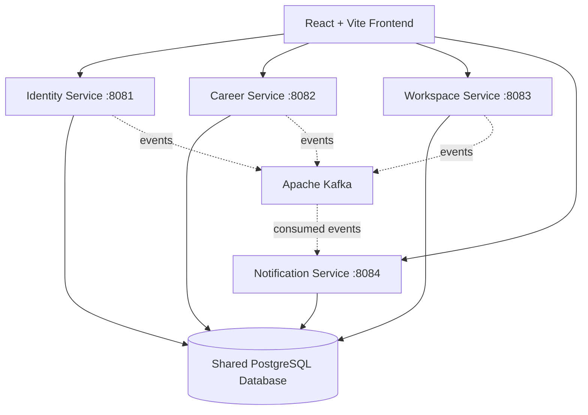
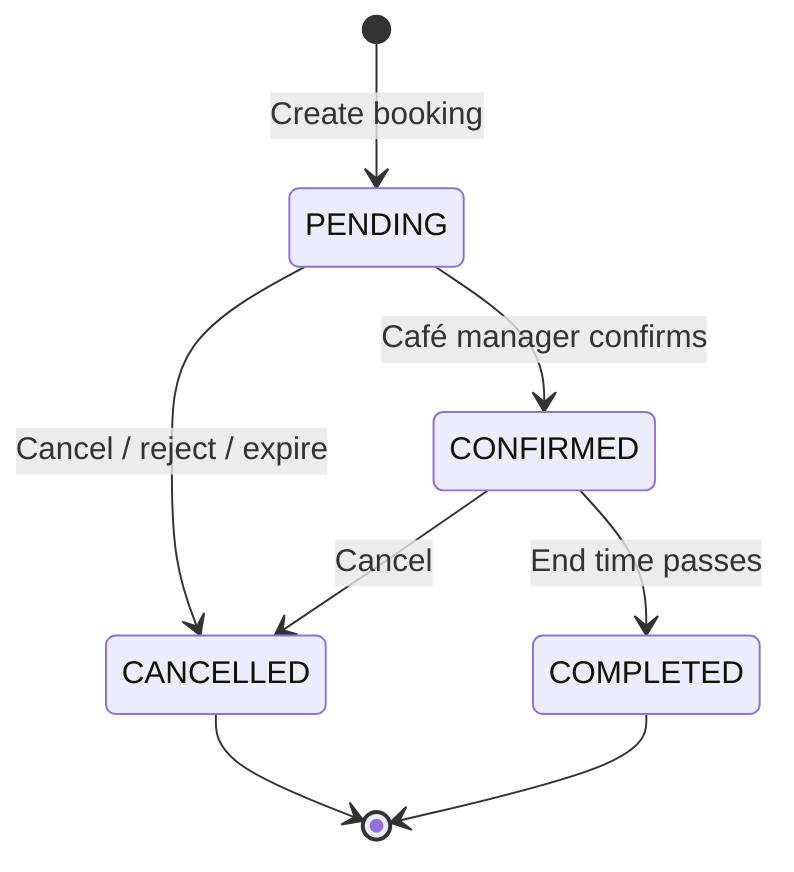
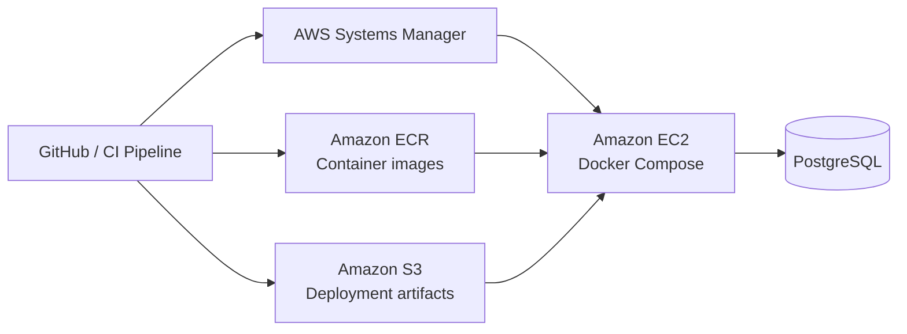

# WASLAH 4.0 — Career & Collaborative Workspace Platform

**A full-stack platform connecting career opportunities, professional development, and bookable study spaces.**

WASLAH helps students, job seekers, employers, and café managers connect through a single application. Users can discover jobs, apply for opportunities, reserve study spaces, and organize collaborative study sessions. Employers manage vacancies and applications, while café managers manage spaces and bookings.

Originally developed as a Spring Boot monolith, WASLAH was subsequently restructured into **four Spring Boot microservices**, with containerization, asynchronous messaging, automated testing, and CI/CD deployment workflows.


## Contents

1. [Overview and roles](#overview-and-roles)
2. [Features](#features)
3. [Architecture](#architecture)
4. [Technology stack](#technology-stack)
5. [Repository layout](#repository-layout)
6. [Business rules and concurrency](#business-rules-and-concurrency)
7. [Running locally](#running-locally)
8. [API and Swagger](#api-and-swagger)
9. [Testing](#testing)
10. [CI/CD and AWS](#cicd-and-aws)
11. [Security and configuration](#security-and-configuration)
12. [Challenges and future improvements](#challenges-and-future-improvements)
13. [Credits and external resources](#credits-and-external-resources)

## Overview and roles

WASLAH addresses two connected needs: **finding meaningful work** and **finding suitable places to study or work**. The application uses role-based access control to separate responsibilities.

| Role | Capabilities |
| --- | --- |
| `USER` | Register, manage a profile, browse/apply for jobs, book study spaces, create/join study sessions, request role upgrades |
| `EMPLOYER` | Publish and manage jobs, review applications, accept or reject candidates |
| `CAFE_MANAGER` | Manage cafés and study spaces, review and decide bookings |
| `ADMIN` | Manage users, review role-upgrade requests, access administrative information and audit history |

## Features

### Identity and access
- User registration, email verification, and JWT-based login.
- BCrypt password hashing, account lockout, and authentication rate limiting.
- Forgot/reset/change-password flows.
- Profile management and profile image upload.
- Administrator-controlled employer and café-manager role upgrades.
- Authorization enforced through Spring Security and resource-ownership checks.

### Career services
- Job creation, browsing, filtering, and application submission.
- Employer review and application status updates.
- Vacancy tracking and lock-protected candidate acceptance to prevent overfilling positions.

### Workspace services
- Café and study-space listings and management.
- Time-slot bookings with overlap validation and manager confirmation/cancellation.
- Automatic expiration of overdue pending bookings and completion of finished bookings.
- Group study sessions linked to confirmed bookings.
- Capacity enforcement, participant management, FIFO-eligible waitlists, and activity history.

### Notifications and user experience
- Stored notifications and real-time delivery using Server-Sent Events (SSE).
- Event-driven communication across services using Apache Kafka as part of the WASLAH 4.0 architecture.
- React/Vite frontend with role-specific interfaces.
- Pagination, filtering, consistent API errors, and Swagger/OpenAPI documentation.

## Architecture

WASLAH 4.0 uses four independently runnable Spring Boot applications. The frontend communicates with the appropriate backend service **directly**; an API gateway is not part of the current design.



| Service | Local port | Responsibility |
| --- | ---: | --- |
| Identity | `8081` | Authentication, user profiles, account management, role requests, administration |
| Career | `8082` | Jobs, applications, employer workflows, vacancy management |
| Workspace | `8083` | Cafés, study spaces, bookings, study sessions, waitlists |
| Notification | `8084` | Notification persistence, event handling, real-time SSE delivery |

**Database decision:** The four services currently share **one PostgreSQL database and one schema**. This is a deliberate project migration decision, not database-per-service isolation. It simplifies the current deployment but creates coupling that would need to be addressed for stronger service autonomy.

**Authentication:** Identity issues signed JWTs. Other services validate tokens using the configured shared JWT secret. The JWT contains the user identifier and role so downstream services can authorize requests without relying on an API gateway.

**Messaging:** Kafka supports asynchronous service-to-service event handling. The exact topic names, producers, consumers, and retry configuration should be read from the current source and deployment configuration.

## Technology stack

| Layer | Technologies |
| --- | --- |
| Backend | Java 17, Spring Boot, Spring Web MVC, Spring Data JPA, Hibernate |
| Security | Spring Security, JWT (`jjwt`), BCrypt, Jakarta Bean Validation |
| Data | PostgreSQL; H2 for applicable test contexts |
| Messaging | Apache Kafka; Server-Sent Events (SSE) |
| Frontend | React, TypeScript, Vite |
| Testing | JUnit 5, Spring Boot Test, Cucumber BDD, Testcontainers, Maven Surefire/Failsafe |
| Packaging | Maven Wrapper, Docker, Docker Compose |
| Automation | GitHub Actions, Jenkins |
| AWS deployment tooling | Amazon EC2, Amazon ECR, Amazon S3, AWS Systems Manager (SSM), IAM; database hosting/configuration depends on deployed environment |
| API documentation | Swagger / OpenAPI |

## Repository layout

```text
updated-waslah/
├── .github/
│   └── workflows/
│       └── ci-cd.yml
├── Jenkinsfile
├── frontend/
├── services/
│   ├── identity_service/
│   ├── career_service/
│   ├── workspace_service/
│   ├── notification_service/
│   └── .env.example
├── infrastructure/
│   ├── docker/
│   │   └── compose.prod.yaml
│   ├── db/
│   │   └── 01-schema.pg17.sql
│   └── aws/
│       └── scripts/
│           └── deploy.sh
└── README.md
```

The former single-application root Maven project was removed during the microservices migration. Each backend service now has its own Maven project and wrapper.

## Business rules and concurrency

### Booking lifecycle



- A booking must have a valid future time interval.
- An unavailable study space cannot be booked.
- Two active bookings cannot overlap for the same space. The overlap condition is `existing.start < requested.end AND existing.end > requested.start`.
- Booking creation uses database transactions and pessimistic row locking to avoid double-booking under concurrent requests.
- Only the booking owner or an authorized manager may perform the applicable cancellation or decision.
- A scheduled task handles expired pending and completed confirmed bookings.

### Group study sessions

- A session is associated with a confirmed booking and cannot exceed its study-space capacity.
- The organizer occupies a participant seat.
- Users cannot join the same session twice or participate in overlapping confirmed sessions.
- Full sessions place eligible users on a FIFO waitlist.
- Leaving a session may promote the next eligible waiting user.
- Booking cancellation and linked session updates must remain transactionally consistent.

### Database locking

Workspace operations use PostgreSQL transaction-scoped advisory locking (`pg_advisory_xact_lock`) for coordinated booking/session mutations, alongside pessimistic row locks and database uniqueness constraints. The advisory lock is released automatically on transaction commit or rollback. Its coarse-grained scope favors correctness but can reduce throughput when unrelated operations compete for the same lock.

Career vacancy acceptance also uses pessimistic locking so simultaneous decisions cannot exceed the number of available vacancies.

## Running locally

### Prerequisites

- Java 17 JDK
- Docker Desktop with Docker Compose **or** locally configured PostgreSQL/Kafka dependencies
- Node.js and npm for the frontend
- Git

### 1. Clone

```powershell
git clone -b master https://github.com/Noor-Shafeeq-Ashoor/updated-waslah.git
cd updated-waslah
```

### 2. Configure secrets

Use `services/.env.example` as the reference for the environment variables required by your chosen startup method. Never commit a populated `.env` file, database passwords, JWT signing secrets, SMTP credentials, or AWS credentials.

Typical variables include:

| Variable | Purpose |
| --- | --- |
| `DB_URL`, `DB_USERNAME`, `DB_PASSWORD` | Shared PostgreSQL connection |
| `JWT_SECRET` | JWT signing/validation secret, consistent across services |
| `KAFKA_BOOTSTRAP` | Kafka broker address |
| `IDENTITY_URL`, `CAREER_URL`, `WORKSPACE_URL`, `NOTIFICATION_URL` | Internal service addresses |
| `MAIL_USERNAME`, `MAIL_APP_PASSWORD` | SMTP configuration for Identity |
| `ADMIN_USERNAME`, `ADMIN_EMAIL`, `ADMIN_PASSWORD` | Optional admin bootstrap configuration |
| `APP_BASE_URL` | Frontend/public URL used for application links |
| `INTERNAL_TOKEN` | Internal service authentication where required |

Set production secrets through your deployment environment or secret-management mechanism, not Git.

### 3. Run a service

From the repository root in **Windows PowerShell**:

```powershell
cd services\identity_service
.\mvnw.cmd spring-boot:run
```

Start the other services in separate terminals using their respective directories. PostgreSQL, Kafka, and any other required infrastructure must be available first. Alternatively, use the Docker Compose configuration appropriate to your environment; check the repository for the exact local Compose filename and command.

### 4. Run the frontend

```powershell
cd frontend
npm ci
npm run dev
```

Vite commonly serves the local frontend at `http://localhost:5173`. Confirm its actual URL and API proxy configuration in the current Vite settings.

## API and Swagger

Each service has its own API surface and may expose its own Swagger UI. The default local Swagger paths are:

| Service | Swagger UI |
| --- | --- |
| Identity | `http://localhost:8081/swagger-ui/index.html` |
| Career | `http://localhost:8082/swagger-ui/index.html` |
| Workspace | `http://localhost:8083/swagger-ui/index.html` |
| Notification | `http://localhost:8084/swagger-ui/index.html` |

These URLs depend on Swagger being enabled in the active profile.

### Representative workflows

| Area | Representative route | Description |
| --- | --- | --- |
| Identity | `POST /auth/register` | Register an account |
| Identity | `POST /auth/login` | Authenticate and obtain a JWT |
| Identity | `GET /auth/verify-email?token=...` | Verify email |
| Career | `GET /api/jobs` | Browse jobs |
| Career | `POST /api/jobs` | Create a job as an employer |
| Career | `POST /api/applications/jobs/{jobId}` | Apply for a job |
| Workspace | `GET /api/cafes` | Browse cafés |
| Workspace | `POST /api/bookings` | Request a study-space booking |
| Workspace | `POST /api/study-sessions` | Create a group session |
| Workspace | `POST /api/study-sessions/{id}/join` | Join or enter waitlist |
| Notification | `GET /api/notifications` | Read stored notifications |

These routes reflect the documented original API; verify the current controllers after the microservices extraction, especially notification stream paths and admin endpoints. Protected requests use `Authorization: Bearer <JWT>`.

## Testing

Each service is independently built and tested with its Maven wrapper. For example, in Windows PowerShell:

```powershell
cd services\workspace_service
$env:SPRING_PROFILES_ACTIVE = "test"
.\mvnw.cmd clean verify
```


## CI/CD and AWS

The repository contains **two pipeline definitions**:

| Pipeline | Role |
| --- | --- |
| `.github/workflows/ci-cd.yml` | GitHub Actions service tests, frontend build, Docker image build, and conditional AWS image publishing/deployment |
| `Jenkinsfile` | Jenkins-based build/test/image workflow and AWS deployment path with a manual approval stage |

### GitHub Actions workflow

The workflow runs on pushes and pull requests targeting `main`/`master`, plus manual dispatch. It runs Maven verification for the four services, builds the frontend, and builds container images. When the required AWS variables, permissions, and branch conditions are satisfied, it can publish images to **Amazon ECR** and initiate deployment using **S3** and **AWS Systems Manager**.

**Deployment is conditional, not guaranteed by a successful local build.** Before pushing to the default branch, confirm whether production deployment is enabled. Avoid configuring both GitHub Actions and Jenkins to deploy automatically to the same instance.

### AWS deployment architecture



The repository includes a production Compose file, a PostgreSQL schema script, and an AWS deployment script. **An actual live EC2 deployment, reachable public URL, and managed database configuration have not been verified from the supplied README alone.**

## Security and configuration

- JWT validation and role-based authorization are applied in each relevant service.
- Registration assigns the base `USER` role; elevated roles require approval.
- Account security includes BCrypt, verification, recovery, rate limiting, and lockout.
- Sensitive configuration is supplied through environment variables.
- Application APIs use validated DTOs and standardized error handling.
- Database-level locks protect concurrent business invariants.
- Do not expose internal tokens, SMTP secrets, JWT secrets, or database credentials in source control or screenshots.

### Standard error format

```json
{
  "timestamp": "2026-10-15T10:30:00",
  "status": 404,
  "error": "RESOURCE_NOT_FOUND",
  "message": "Booking not found",
  "path": "/api/bookings/42"
}
```

## Challenges and future improvements

### Engineering challenges

1. **Extracting the monolith:** Separating Identity, Career, Workspace, and Notification responsibilities while preserving existing authentication and business rules.
2. **Maintaining transactional correctness:** Preventing overlapping bookings, over-capacity study sessions, duplicate promotions, and overfilled job vacancies.
3. **Event-driven notifications:** Coordinating business transactions with asynchronous messaging and real-time SSE delivery.
4. **Testing true concurrency:** Running real PostgreSQL integration tests, rather than relying exclusively on H2 or sequential requests.
5. **Deployment automation:** Coordinating Docker images, configuration, CI/CD credentials, and AWS deployment scripts.

### Potential next steps

- Move from the shared database/schema toward service-owned data and explicit contracts.
- Introduce stronger Kafka retry, dead-letter, idempotency, and observability guarantees where needed.
- Add frontend integration/end-to-end tests.
- Refine advisory locking to reduce contention while preserving correctness.
- Extend CI reports to include both Surefire and Failsafe XML results.
- Verify production smoke tests and document actual deployment endpoints and infrastructure state.

## Credits and external resources

The following resources were listed in the original WASLAH documentation and are retained here, with additional references relevant to WASLAH 4.0.

| Resource | URL | Used for |
| --- | --- | --- |
| Spring Boot Documentation | https://docs.spring.io/spring-boot/ | Application setup, configuration, JPA, web MVC |
| Spring Security Documentation | https://docs.spring.io/spring-security/reference/ | Security filter chain, authorization, BCrypt |
| jjwt | https://github.com/jwtk/jjwt | Generating and validating JWTs |
| springdoc-openapi | https://springdoc.org/ | Swagger UI / OpenAPI |
| PostgreSQL Documentation | https://www.postgresql.org/docs/ | Database setup, SQL, transactions, locking |
| Project Lombok | https://projectlombok.org/ | Boilerplate reduction |
| Java Concurrency Tutorial | https://docs.oracle.com/javase/tutorial/essential/concurrency/ | Threads, synchronization, concurrency concepts |
| Java ExecutorService API | https://docs.oracle.com/en/java/javase/17/docs/api/java.base/java/util/concurrent/ExecutorService.html | Concurrent test execution |
| Apache Kafka Documentation | https://kafka.apache.org/documentation/ | Asynchronous messaging concepts |
| Docker Documentation | https://docs.docker.com/ | Containers and Compose |
| GitHub Actions Documentation | https://docs.github.com/en/actions | CI/CD workflows |
| Jenkins Documentation | https://www.jenkins.io/doc/ | Pipeline automation |
| AWS Documentation | https://docs.aws.amazon.com/ | EC2, ECR, S3, Systems Manager, IAM |
| Testcontainers Documentation | https://java.testcontainers.org/ | PostgreSQL integration testing |
| Cucumber Documentation | https://cucumber.io/docs/cucumber/ | Behavior-driven testing |

---

**WASLAH 4.0** — Java / Spring Boot microservices, React, PostgreSQL, Kafka, Docker, automated testing, and AWS-oriented CI/CD.
