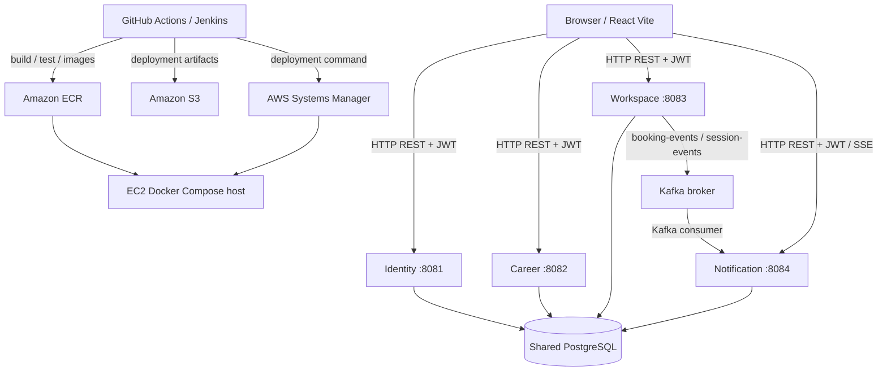

# WASLAH 4.0 — Final Architecture

## Current architecture
WASLAH migrated from one layered Spring Boot application into four separately runnable Spring Boot services and a React/Vite frontend. The frontend routes HTTP calls to each service directly (there is **no API Gateway**). Services are separately packaged, but **all share one PostgreSQL database and one schema**. Docker Compose supplies service discovery through container DNS. JWTs are issued by Identity and validated by the other services.

**Diagram qualification:** The AWS segment describes the repository's configured deployment flow; it does not certify a successful live deployment.

## Responsibilities
| Service | Port | Owns application logic |
|---|---:|---|
| Identity | 8081 | Registration, email verification, JWT login, profiles, passwords, user roles, admin approvals and account administration |
| Career | 8082 | Job offers, employer ownership, applications, vacancy counts and acceptance/rejection |
| Workspace | 8083 | Cafés, study spaces, bookings, booking scheduler, study sessions, participants and FIFO waitlists |
| Notification | 8084 | Kafka notification ingestion, stored notifications, unread counts, and real-time SSE |

## Communication: synchronous and asynchronous
**Synchronous REST:** Browser-to-service requests return an HTTP result, enforce JWT/role/ownership checks and typically complete a business transaction before returning. Cross-service HTTP URLs (`IDENTITY_URL`, `CAREER_URL`, etc.) are configured for internal lookups where needed. A failing synchronous dependency may delay or fail the request.

**Asynchronous Kafka:** Workspace serializes notification events as JSON and publishes to `booking-events` or `session-events`. Notification consumes them independently and makes them available for persistence/SSE. The original business action should not wait for the end user's SSE connection. Kafka consumer retries, deduplication and operational monitoring are distinct concerns from synchronous API validation.

**Concurrency:** PostgreSQL row locks prevent overlapping bookings; PostgreSQL transaction-level advisory locks serialize session participation and booking-related changes. Career's vacancy acceptance uses row locking to prevent overfilling.

## Data ownership and flow
The four services share the **same physical PostgreSQL schema**, not separate schemas/databases. Ownership is logical: Identity handles users/profiles; Career jobs/applications; Workspace cafés/bookings/sessions; Notification notifications/processed event records. The shared schema creates coupling and should not be described as strict database-per-service architecture. A typical flow is: Identity issues JWT → browser sends JWT to Workspace → Workspace checks/commits booking → Workspace emits Kafka notification → Notification consumes/stores → browser receives SSE or reads stored notifications.

## Infrastructure and deployment
- **Local:** `infrastructure/docker/compose.yaml` runs PostgreSQL, Kafka, the four services and frontend; `--profile tools` adds Kafka UI. Docker networking uses service names, not localhost.
- **Production-oriented:** `infrastructure/docker/compose.prod.yaml` and `infrastructure/aws/scripts/deploy.sh` support deployment on EC2; ECR stores container images; S3 holds deployment artifacts; Systems Manager runs deployment commands.
- **CI/CD:** `.github/workflows/ci-cd.yml` runs Maven `verify` across all four services, builds frontend/images, and conditionally publishes/deploys. `Jenkinsfile` provides an alternate pipeline. Avoid having both independently deploy to the same host.
- **Security:** Secrets via environment/CI secret stores; never commit `.env`. IAM roles/OIDC are preferable to static AWS keys.
- **Operational limitation:** local Kafka is single-broker and non-HA; shared database remains a coupling point.

## Verification status
Repository configuration and code were inspected from an uploaded project snapshot. A completed AWS deployment, public health endpoint and all GitHub Actions jobs are **not verified** by the snapshot alone.
