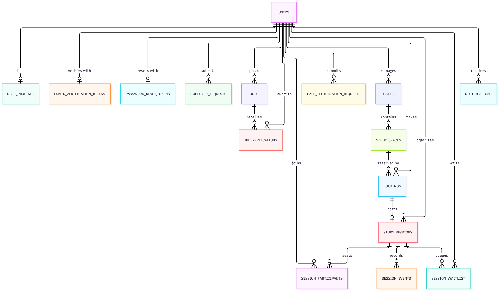
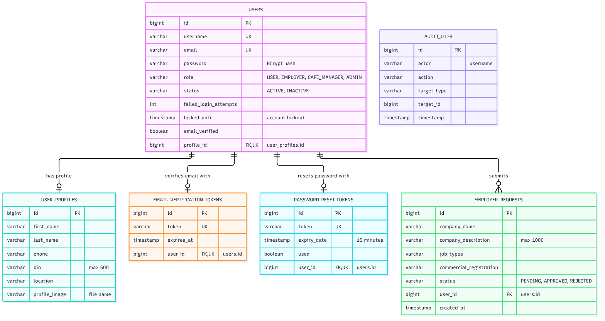
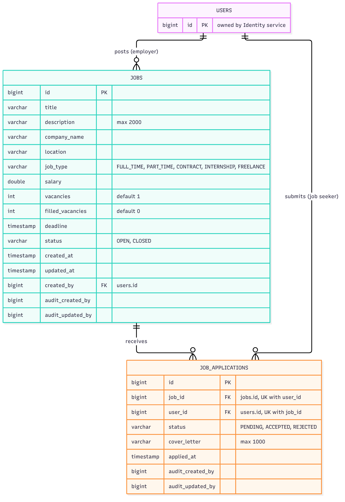
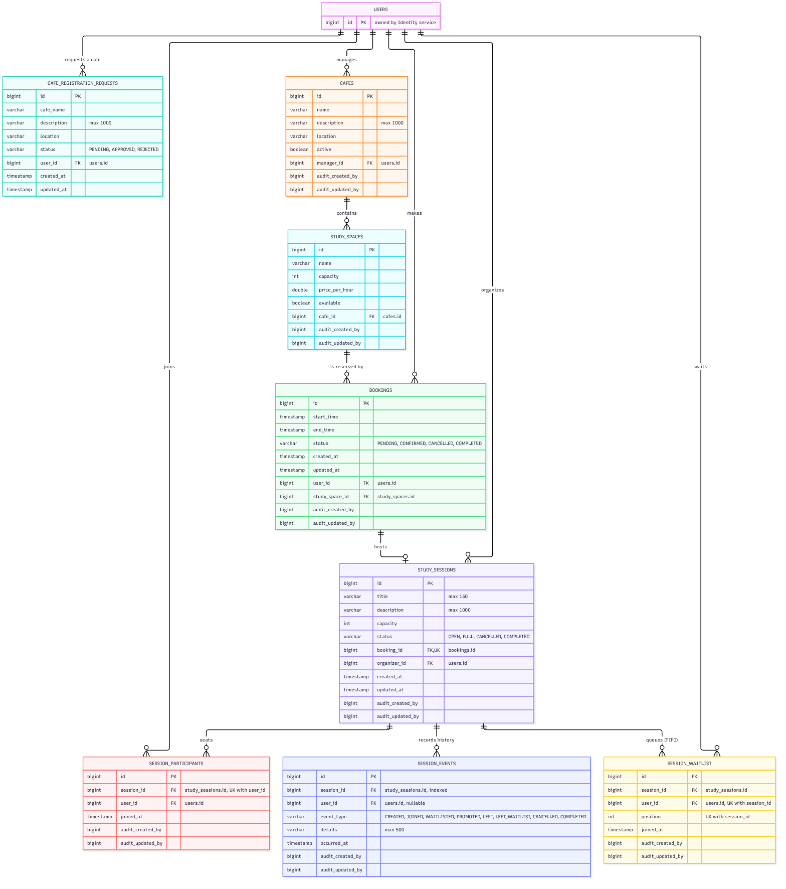
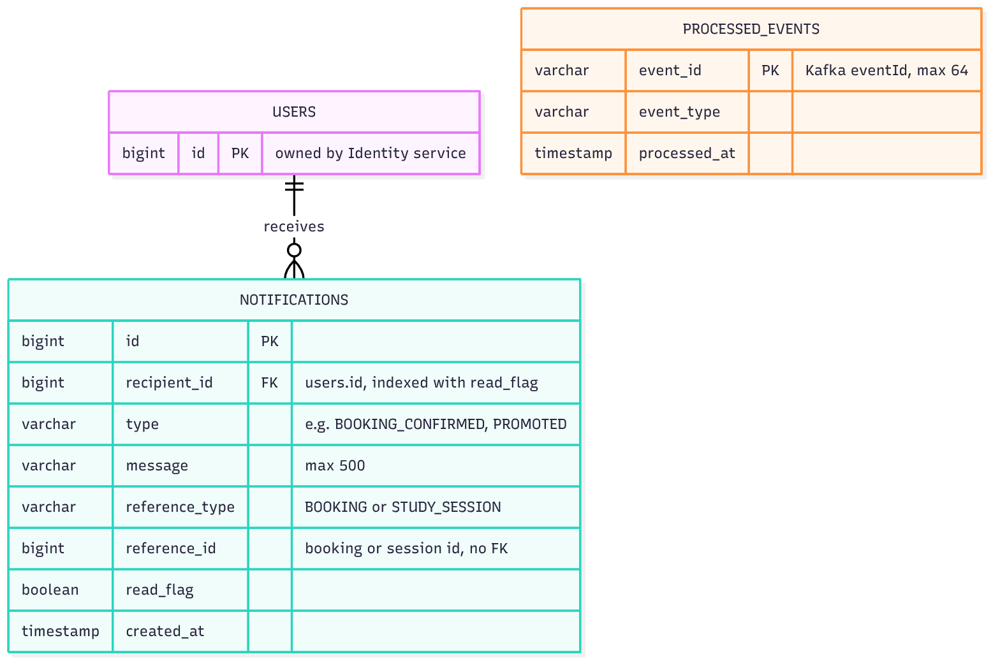

# WASLAH 4.0 — Entity Relationship Diagrams

WASLAH stores its data in **one PostgreSQL database (18 tables)**. Each table is **owned by exactly one microservice**: only that service reads and writes it through JPA. Services refer to data owned by another service **by id only** (for example `user_id`); they never join or map another service's entity. When a service needs user details (name, email, role), it asks the Identity service through its internal API.

Diagram sources (Mermaid) are in [`docs/erd/`](erd/); the images below are generated from them.

**Notation:** `PK` primary key · `FK` foreign key · `UK` unique · `||--o{` one-to-many · `||--o|` one-to-zero-or-one. Enumerations are stored as text (`varchar`).

## 1. Overview: all services

| Service | Port | Tables it owns | Count |
| --- | ---: | --- | ---: |
| Identity | 8081 | `users`, `user_profiles`, `email_verification_tokens`, `password_reset_tokens`, `employer_requests`, `audit_logs` (shared write, see below) | 6 |
| Career | 8082 | `jobs`, `job_applications` | 2 |
| Workspace | 8083 | `cafe_registration_requests`, `cafes`, `study_spaces`, `bookings`, `study_sessions`, `session_participants`, `session_waitlist`, `session_events` | 8 |
| Notification | 8084 | `notifications`, `processed_events` | 2 |

**`users.id` is the link between services.** Career, Workspace and Notification keep `user_id`-style columns (`created_by`, `manager_id`, `organizer_id`, `recipient_id` …). In the database these columns still have foreign keys to `users.id`, inherited from the original monolith schema, so a row can never point to a user that does not exist. In the code they are plain `Long` values, not JPA relationships.

**`audit_logs`** is written by Identity, Career and Workspace (each records its own actions: who, what, which record, when) and read by the admin audit page in Identity.

**Audit columns:** every Career and Workspace table except `cafe_registration_requests` also has `audit_created_by` and `audit_updated_by` (the user id that created or last changed the row), filled automatically by Spring Data JPA auditing.

---

## 2. Identity service

| Entity (table) | Purpose |
| --- | --- |
| `User` (`users`) | Account: login name, email, BCrypt password, role, status, lockout counters, email verification flag |
| `UserProfile` (`user_profiles`) | Personal details and profile image |
| `EmailVerificationToken` (`email_verification_tokens`) | One-time link sent at registration to verify the email address |
| `PasswordResetToken` (`password_reset_tokens`) | One-time password reset link, valid 15 minutes, marked `used` after use |
| `EmployerRequest` (`employer_requests`) | A user's request to become an employer; an admin approves or rejects it |
| `AuditLog` (`audit_logs`) | Security and business action history (shared, see overview) |

| Relationship | Cardinality | Enforced by |
| --- | --- | --- |
| User → UserProfile | 1 to 0..1 | `users.profile_id` FK + unique; profile saved and deleted with the user (cascade) |
| User → EmailVerificationToken | 1 to 0..1 | `user_id` FK + unique |
| User → PasswordResetToken | 1 to 0..1 | `user_id` FK + unique |
| User → EmployerRequest | 1 to many | `employer_requests.user_id` FK |

Rules held by the data: `username` and `email` are unique; tokens are unique; `role` is one of `USER`, `EMPLOYER`, `CAFE_MANAGER`, `ADMIN` (new accounts are always `USER`; higher roles come only through an approved request).

---

## 3. Career service

| Entity (table) | Purpose |
| --- | --- |
| `Job` (`jobs`) | A vacancy posted by an employer: details, type, salary, number of vacancies and how many are filled, deadline, status |
| `JobApplication` (`job_applications`) | A job seeker's application to one job, with cover letter and decision status |

| Relationship | Cardinality | Enforced by |
| --- | --- | --- |
| Job → JobApplication | 1 to many | `job_applications.job_id` FK (JPA `@ManyToOne`) |
| User (Identity) → Job | 1 to many | `jobs.created_by` = employer's user id |
| User (Identity) → JobApplication | 1 to many | `job_applications.user_id` = applicant's user id |

Rules held by the data: a user can apply **once per job** (unique `job_id` + `user_id`); `filled_vacancies` never exceeds `vacancies` (accepting an applicant locks the job row, so two simultaneous acceptances cannot overfill it).

---

## 4. Workspace service

| Entity (table) | Purpose |
| --- | --- |
| `CafeRegistrationRequest` (`cafe_registration_requests`) | A user's request to list a café and become a café manager; an admin decides |
| `Cafe` (`cafes`) | A café run by one café manager; can be activated or deactivated |
| `StudySpace` (`study_spaces`) | A bookable desk or room inside a café, with capacity and hourly price |
| `Booking` (`bookings`) | A user's reservation of a study space for a time slot |
| `StudySession` (`study_sessions`) | A group study session created from a confirmed booking |
| `SessionParticipant` (`session_participants`) | A user holding a seat in a session (the organizer takes the first seat) |
| `SessionWaitlist` (`session_waitlist`) | Users waiting for a seat, in first-come-first-served order |
| `SessionEvent` (`session_events`) | The session's history: created, joined, waitlisted, promoted, left, cancelled, completed |

| Relationship | Cardinality | Enforced by |
| --- | --- | --- |
| Cafe → StudySpace | 1 to many | `study_spaces.cafe_id` FK |
| StudySpace → Booking | 1 to many | `bookings.study_space_id` FK |
| Booking → StudySession | 1 to 0..1 | `study_sessions.booking_id` FK + unique |
| StudySession → SessionParticipant | 1 to many | `session_id` FK |
| StudySession → SessionWaitlist | 1 to many | `session_id` FK |
| StudySession → SessionEvent | 1 to many | `session_id` FK (indexed) |
| User (Identity) → Cafe | 1 to many | `cafes.manager_id` |
| User (Identity) → Booking / StudySession / SessionParticipant / SessionWaitlist / CafeRegistrationRequest | 1 to many | `user_id` / `organizer_id` columns |

Rules held by the data and the service:

- **No double booking:** two active bookings of one space cannot overlap (`start < other.end AND end > other.start`), checked under a row lock.
- **One session per booking:** unique `booking_id`.
- **No duplicate seat or queue entry:** unique (`session_id`, `user_id`) in participants and in the waitlist; unique (`session_id`, `position`) keeps the queue order unambiguous.
- **Capacity:** participants never exceed the session capacity, which never exceeds the study space capacity; joining, leaving and promotion run under a PostgreSQL advisory lock.
- Statuses: booking `PENDING → CONFIRMED → COMPLETED`, or `CANCELLED`; session `OPEN ⇄ FULL`, then `COMPLETED` or `CANCELLED`.

---

## 5. Notification service

| Entity (table) | Purpose |
| --- | --- |
| `Notification` (`notifications`) | A message for one user (e.g. booking confirmed, promoted from waitlist), with read/unread state |
| `ProcessedEvent` (`processed_events`) | The id of every Kafka event already handled, so a redelivered event never creates a duplicate notification |

| Relationship | Cardinality | Enforced by |
| --- | --- | --- |
| User (Identity) → Notification | 1 to many | `notifications.recipient_id` (indexed with `read_flag` for the unread count) |
| Notification → Booking / StudySession | logical only | `reference_type` + `reference_id`, no FK (the data lives in Workspace) |

`processed_events` has no relationship to other tables: its primary key is the `eventId` carried by each Kafka message. Saving the notification and the processed event happens in one transaction, which makes event handling idempotent.

## Physical schema

Exact column types, constraint names and indexes: [`infrastructure/db/01-schema.pg17.sql`](../infrastructure/db/01-schema.pg17.sql).
