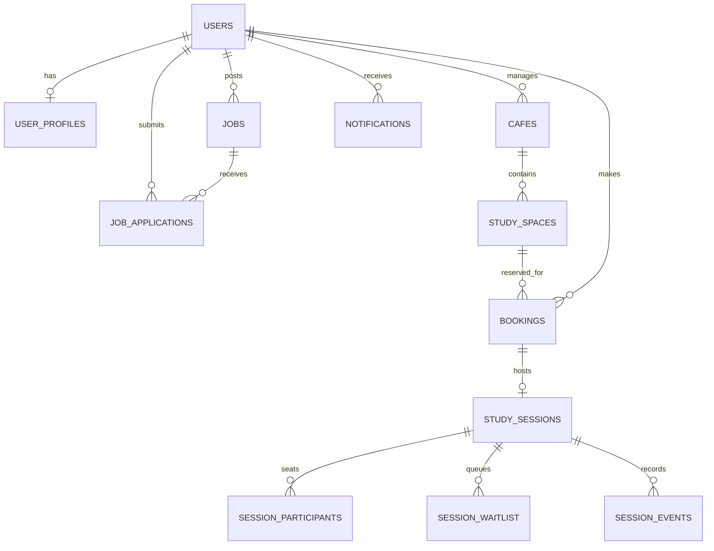

# WASLAH 4.0 — Updated Logical ERD

**Important:** The microservice split did not imply four separate databases. The current architecture uses **one shared PostgreSQL database and one schema**. This diagram shows the main domain relationships and logical service ownership, not an exhaustive physical DDL inventory. For column types and constraints use `infrastructure/db/01-schema.pg17.sql` and `03-processed-events.sql`.

| Logical owner | Main tables/entities |
|---|---|
| Identity | Users, user profiles, email verification and reset tokens, employer requests |
| Career | Jobs, job applications |
| Workspace | Cafés, study spaces, bookings, café registration requests, study sessions, participants, waitlist, session events |
| Notification | Notifications, processed events |
| Cross-cutting | Audit logs and user IDs referenced by other services |

The legacy Project 3 ERD contains richer attribute detail; retain it as historical documentation. In the extracted services, references to users can be scalar user IDs rather than JPA associations, even though physical tables still share the database. Validate any foreign-key claims against the deployed schema.
